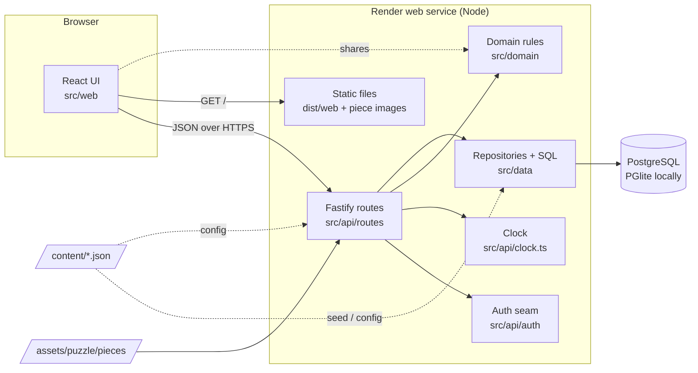
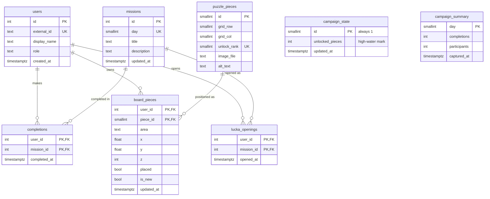

# ARCHITECTURE – Miljöjulkalendern

## Components



The domain layer has no framework or database imports. Both the server (authoritative) and the
client (instant feedback, for example snapping) use it.

## Data model



## Tick off → counter → piece unlock → board update

```mermaid
sequenceDiagram
  actor U as User
  participant W as Web UI
  participant A as API
  participant D as Domain
  participant DB as PostgreSQL

  U->>W: "Jag har gjort det!" (lucka d)
  W->>A: POST /api/completions {day: d}
  A->>D: missionStatus(d, today(Europe/Stockholm))
  alt lucka not open / campaign closed
    A-->>W: 409 MISSION_LOCKED / CAMPAIGN_CLOSED
  else open
    A->>DB: BEGIN; SELECT campaign_state FOR UPDATE
    A->>DB: INSERT completion ON CONFLICT DO NOTHING
    A->>DB: SELECT count(*) FROM completions
    A->>D: nextHighWaterMark(stored, total)
    A->>DB: UPDATE campaign_state SET unlocked_pieces = GREATEST(...); COMMIT
    A-->>W: 200 {completed, newlyUnlockedPieces, progress}
  end
  W->>W: update counter; announce
  opt newlyUnlockedPieces > 0
    W->>A: GET /api/board
    A->>DB: INSERT missing board_pieces at random tray positions ON CONFLICT DO NOTHING
    A-->>W: pieces (new ones marked isNew)
    W->>A: GET /api/pieces/:id/image
    W-->>U: "En ny pusselbit är upplåst!"
  end
```

## Layers and folders

| Folder       | Responsibility                                         | May import                 |
| ------------ | ------------------------------------------------------ | -------------------------- |
| `src/domain` | Pure rules: calendar, pieces, unlock order, board/snap | nothing                    |
| `src/shared` | zod contract shared by API and UI                      | `zod`, `src/domain` types  |
| `src/data`   | DB adapter, migrations, repositories, seed             | `src/domain`               |
| `src/api`    | Config, clock, auth, routes, app wiring                | everything above           |
| `src/web`    | React UI                                               | `src/shared`, `src/domain` |
| `scripts`    | CLI entry points (dev, migrate, seed, purge, smoke)    | `src/*`                    |
